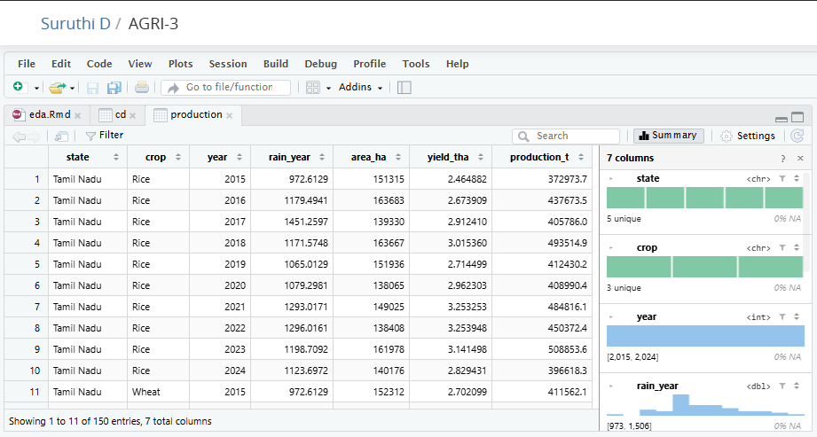
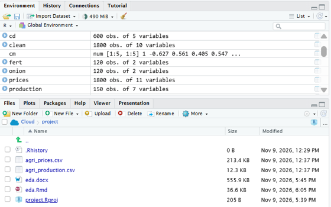
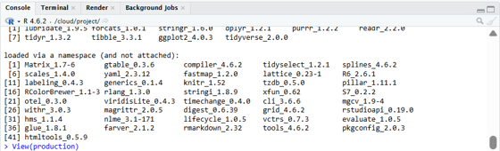

# 🌾 Agribusiness Trends – Exploratory Data Analysis (EDA)

## 📌 Project Overview

This project focuses on Exploratory Data Analysis (EDA) of agribusiness trends using R and RStudio. It explores agricultural production and market price datasets to understand patterns, relationships, seasonal variations, and trends within the agricultural sector.

The project demonstrates how data analysis techniques can transform agricultural datasets into meaningful insights through data cleaning, statistical analysis, visualization, and interpretation.

## 🎯 Project Objectives

- Explore agricultural production and market price datasets.
- Understand regional and crop-wise production patterns.
- Analyse seasonal and temporal trends.
- Examine relationships between rainfall, yield, arrivals, and prices.
- Identify missing values and statistical anomalies.
- Create meaningful visualizations for data interpretation.
- Develop a structured and reproducible EDA workflow using R Markdown.


## 📂 Files Included

| File Name | Description |
|---|---|
| `eda.Rmd` | R Markdown source file containing the analysis code and workflow. |
| `agri_production.csv` | Dataset containing agricultural production-related information. |
| `agri_prices.csv` | Dataset containing agricultural market price-related information. |
| `EDA_Report.docx` | Detailed project documentation describing the EDA methodology, business questions, analysis techniques, visualization plan, and expected outcomes. |
| `README.md` | Project overview, instructions, tools, methodology, limitations, and conclusion. |
| `images/grab/` | Contains screenshots of project execution and analysis in RStudio. |

## 📊 Datasets

This project uses two agricultural datasets:

### 1. Agricultural Production Dataset

**File:** `agri_production.csv`

Used to explore agricultural production patterns, crop-wise performance, regional differences, and yield-related information.

### 2. Agricultural Market Prices Dataset

**File:** `agri_prices.csv`

Used to explore agricultural market prices, price movements, seasonal variations, and market-related trends.

## 🛠️ Tools and Technologies

- **Programming Language:** R
- **IDE:** RStudio
- **Reporting:** R Markdown
- **Data Manipulation:** tidyverse
- **Date Handling:** lubridate
- **Data Visualization:** ggplot2
- **Version Control:** Git and GitHub

## 🔍 Analysis Covered

1. Data profiling and cleaning
2. Descriptive statistical analysis
3. Regional and crop-wise analysis
4. Seasonal and time-series analysis
5. Market price and arrivals analysis
6. Statistical anomaly detection
7. Correlation and relationship analysis
8. Data visualization and interpretation

## ⚙️ Installation and Usage

### Step 1: Clone the Repository

```bash
git clone https://github.com/YOUR-USERNAME/Agribusiness-EDA.git
```

### Step 2: Open the Project

Open the downloaded repository folder in RStudio.

### Step 3: Install Required Packages

```r
install.packages("tidyverse")
install.packages("lubridate")
install.packages("rmarkdown")
```

### Step 4: Run the Analysis

Open `eda.Rmd` in RStudio and execute the code chunks.

### Step 5: Generate the Report

Use the **Knit** option in RStudio to generate the report in the configured output format.

## 📈 Expected Outcomes

- Understanding agricultural production patterns.
- Identification of seasonal market trends.
- Insights into agricultural price movements.
- Better understanding of relationships between weather and yield.
- Identification and review of unusual observations.
- A structured and reproducible EDA reporting workflow.

## ⚠️ Limitations

- The analysis depends on the availability, accuracy, and completeness of the provided datasets.
- Missing values and inconsistent records may affect the reliability of statistical results.
- Observed correlations do not necessarily indicate causal relationships.
- External factors such as government policies, market conditions, and climate variations may influence agricultural trends but may not be fully represented in the datasets.
- The project focuses on exploratory analysis rather than a fully developed predictive forecasting model.
- Findings should be interpreted within the scope and limitations of the available data.

## 🏁 Conclusion

This Exploratory Data Analysis project provides a structured approach to understanding agribusiness trends using R and R Markdown. Through data cleaning, statistical analysis, regional comparisons, seasonal analysis, correlation assessment, and visualization, the project demonstrates how agricultural datasets can be transformed into meaningful insights.

The analysis helps explore production patterns, market price movements, seasonal variations, and relationships between agricultural and environmental factors. It also highlights the importance of identifying anomalies and maintaining data quality throughout the analytical process.

Overall, this project strengthens practical knowledge of R programming, data manipulation, statistical analysis, and data visualization while demonstrating the value of exploratory data analysis in understanding the agricultural sector.

## 📑 Project Documentation

The detailed Word report, `EDA_Report.docx`, provides the project blueprint, methodology, business questions, analysis plan, visualization techniques, worked examples, and expected outcomes.

## 💻 Grab


_Fig : The production data frame (150 rows, 7 columns) in the RStudio data viewer_

_Fig : Environment pane (data frames in the session) and Files pane (eda.Rmd, eda.docx and project files)_

_Fig : R console showing R 4.6.2 and the loaded packages (tidyverse 2.0.0, ggplot2 4.0.3)_

## ⭐ Acknowledgement

This project is developed as a practical exploration of data analytics techniques using R, with a focus on understanding agribusiness trends through exploratory data analysis.
